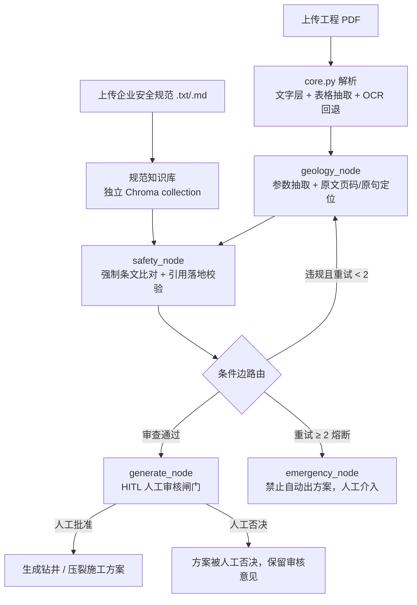

# 🛢️ Oilfield Agent Review · 油气钻井 / 压裂方案智能审查多智能体系统

> 上传工程地质 PDF 与企业安全规范文本，由多智能体工作流完成 **参数抽取 → 强制条文比对 → 带页码级引用溯源 → 人工审核闸门 → 方案生成**；任何违规项都会被逐条打回，超过重试上限自动熔断，禁止自动出方案。

[](https://www.python.org/)
[](https://streamlit.io/)
[](https://langchain-ai.github.io/langgraph/)
[](LICENSE)

---

## 1. 项目背景与定位

在钻井、完井与压裂工程中，设计参数是否符合企业安全规范，通常依赖人工逐条翻查地质设计书与规范条文，存在 **漏判、引用无出处、模型转述失真** 等风险。

本项目是一套面向 **工程辅助审查场景** 的多智能体 Demo：

- 从工程 PDF 中抽取地层与工程参数，并把每个参数 **定位回原文页码与原句**；
- 将参数逐条对照企业规范条文，输出结构化冲突报告（违规参数、地质来源、规范来源、判定意见）；
- 审查不通过的参数回退重做，连续超限则熔断；通过后再经人工审核闸门，才生成最终方案。

> ⚠️ **定位说明**：本项目为工程辅助工具 / 教学演示，**不构成工程设计依据**。AI 提取与生成的内容必须由具备相应资质的工程师审核、签字后方可采用。

## 2. 核心特性

| 能力 | 说明 |
|---|---|
| **强制引用溯源** | 页码与原句由程序从 PDF 原文反查计算，**不采信模型自报的出处**；模型谎报页码时会被真实定位覆盖。 |
| **条文落地校验** | 模型引用的规范条文会与规范原文逐条比对：原句 / 合法转述可通过；**阈值数字被改动、纯编造条文一律判为未核实**，未核实仍按不安全处理并给出警示。 |
| **Fail-closed 安全闸门** | 未上传规范、文本乱码、参数解析失败、模型自相矛盾（`is_safe=true` 却给出违规项）等情况，一律拦截，不放行。 |
| **反思重试 + 熔断** | 审查不通过回退地质节点重做，最多重试 `MAX_RETRIES=2` 次；仍不通过则进入熔断节点，禁止自动生成方案。 |
| **HITL 人工审核** | 方案生成前设置人工审核闸门：可批准、可否决并填写意见；未批准不产出成品。 |
| **双向量库隔离** | 地质 PDF 库与企业规范库使用独立 Chroma collection，互不串味；规范按整行切块，条款编号不被劈开。 |
| **离线可运行** | 嵌入默认使用零依赖的本地哈希向量；向量库不可用时自动降级为本地条款关键词检索，比对流程不中断。 |
| **状态持久化** | LangGraph 检查点写入 SQLite，会话 ID（thread_id）同步到 URL，刷新页面后可恢复进度、继续人工审核。 |
| **异常兜底** | 文件解析、LLM 调用、向量库构建各环节均有 `try/except` 兜底，避免网页红屏崩溃。 |

## 3. 系统架构

### 3.1 工作流



### 3.2 节点说明

| 节点 | 职责 |
|---|---|
| `geology_node` | 调用 LLM 从解析文本中抽取地层与工程参数；程序在原文中为每个参数定位 `{文件, 页码, 原句}`。 |
| `safety_node` | 检索规范条文，将参数逐条比对；输出 `{is_safe, violations[parameter/extracted_value/extracted_source/rule_source/comment], hard_problems}` 冲突报告；完成条文落地校验。 |
| `generate_node` | 携带已审查通过的参数与审查结论生成 Markdown 方案；启用 HITL 时先 `interrupt` 等待人工确认。 |
| `emergency_node` | 熔断：汇总风险等级、重试次数与失败原因，输出人工介入建议。 |

### 3.3 冲突报告结构（`conflict_report`）

```json
{
  "is_safe": false,
  "violations": [
    {
      "parameter": "压力系数",
      "extracted_value": "1.58",
      "extracted_source": "《地质设计 PDF》第 2 页：“目的层地层压力系数 1.58，属异常高压”",
      "rule_source": "《公司安全规范》第3条：压力系数不得超过 1.4",
      "comment": "严重违规，存在井喷风险，必须打回！",
      "rule_verified": true,
      "rule_match_ratio": 1.0
    }
  ],
  "hard_problems": [],
  "checked_params": 4,
  "spec_chunk_count": 1
}
```

## 4. 快速开始

### 4.1 环境要求

- Python 3.10+（开发环境为 Python 3.14）
- 可访问 DeepSeek 接口（或其他 OpenAI 兼容端点）的网络环境
- 纯文字层 PDF 即可运行；扫描件 OCR 需要额外安装 `easyocr`（体积较大，含 torch）

### 4.2 安装依赖

```powershell
# Windows
python -m venv .venv
.venv\Scripts\activate
pip install -r requirements.txt
```

```bash
# macOS / Linux
python -m venv .venv
source .venv/bin/activate
pip install -r requirements.txt
```

### 4.3 配置 API Key

三种方式任选其一，优先级从高到低：

1. **侧边栏输入**：启动后在左侧 API Key 输入框填写（仅存当前会话）；
2. **secrets 文件**：写入 `.streamlit/secrets.toml`：
   ```toml
   DEEPSEEK_API_KEY = "sk-你的密钥"
   ```
3. **环境变量**：
   ```powershell
   $env:DEEPSEEK_API_KEY = "sk-你的密钥"
   ```

> 仓库中 **不包含任何真实密钥**；`.streamlit/secrets.toml` 已在 `.gitignore` 中排除。

### 4.4 启动

```bash
streamlit run app.py
```

操作流程：

1. 左侧上传 **企业安全规范**（`.txt` / `.md`，可参考 `examples/sample_safety_spec.txt`）；
2. 主区上传一个或多个 **工程 PDF**；
3. 点击「开始分析」，观察节点流转与冲突报告；
4. 启用 HITL 时，在人工审核面板确认（批准 / 否决）后才生成方案。

## 5. 配置项（环境变量）

| 变量 | 默认值 | 说明 |
|---|---|---|
| `DEEPSEEK_API_KEY` | — | LLM 密钥；也可通过侧边栏或 secrets.toml 提供。 |
| `DEEPSEEK_BASE_URL` | `https://api.deepseek.com` | OpenAI 兼容端点；切换本地 Ollama 时指向 `http://localhost:11434/v1`。 |
| `DEEPSEEK_MODEL` | `deepseek-chat` | 模型名；本地 Ollama 可改为 `qwen2.5`。 |
| `LLM_TIMEOUT` | `120` | LLM 请求超时时间（秒）。 |
| `EMBED_BACKEND` | `local` | 嵌入后端：`local`（本地哈希向量，离线可用）/ `hf`（HuggingFace 句向量模型）。 |
| `EMBED_MODEL` | `paraphrase-multilingual-MiniLM-L12-v2` | `hf` 后端使用的模型名。 |
| `APP_DATA_DIR` | 代码所在目录 | 向量库与 SQLite 检查点库的落盘目录。 |
| `PDF_TXT_OUT_DIR` | core.py 默认目录 | 命令行解析时文本输出目录。 |

> 切换本地 Ollama：先启动 `ollama serve` 并 `ollama pull qwen2.5`，再设置 `DEEPSEEK_BASE_URL=http://localhost:11434/v1`、`DEEPSEEK_MODEL=qwen2.5`，Key 填任意占位符即可，代码无需改动。

## 6. 目录结构

```
.
├── app.py                              # Streamlit 前端 + LangGraph 工作流编排（节点、条件边、引用校验）
├── core.py                             # 通用 PDF 解析：pymupdf 文字层 + pdfplumber 表格 + easyocr 回退
├── requirements.txt                    # 依赖清单
├── examples/
│   └── sample_safety_spec.txt          # 示例安全规范（虚构条款，演示比对流程用）
└── README.md
```

> `chroma_db/`、`*.sqlite*`、`__pycache__/`、secrets 文件与原始工程 PDF 均为本地运行产物，已在 `.gitignore` 中排除，不会进入版本库。

## 7. 强制引用溯源的实现要点

- **出处由程序计算，而非模型自述**：解析文本自带页码标记，程序按字符偏移换算真实页码，并在原文中检索参数值，返回文件、页码与原句；定位时会规避坐标 / 经纬度数字与参数值撞车的情况。
- **条文必须落地到原文**：引用条文拆成子句与规范原文比对；数字阈值必须逐字一致，去掉数字后的文字允许同义转述；无法落地的条文标记 `rule_verified=false`，仍按不安全处理。
- **全量规范兜底**：规范文本较短（≤ 2 万字符）时直接全文送入审查提示词，避免检索漏召回导致漏判。
- **无规范不跑**：未上传企业规范时，强制比对缺少基准，流程在开跑前即被拦截。

## 8. 商业价值

1. **审查留痕、可追溯**：每条判定都能回溯到具体 PDF 页码、原句与规范条款，满足合规归档、复核与责任界定要求。
2. **降低人工漏判**：参数与规范逐条机器比对，模型漏引、误引、编造条文会被程序拦截，减少人工翻查工作量。
3. **人机分工清晰**：AI 负责初筛与整理依据，有资质工程师在 HITL 闸门把关并承担签字责任，工具不替代专业判断。
4. **规范可替换复用**：不同企业 / 项目只需上传各自的规范文本，即可复用整套抽取、比对与打回流程。
5. **部署灵活**：云端 LLM（DeepSeek / OpenAI 兼容端点）与本地 Ollama 均可接入；嵌入后端支持离线模式，适配内网与受限网络环境。

## 9. 局限与免责声明

- 本项目为 **辅助审查 Demo**，输出内容可能存在抽取错误、误判或幻觉；**不得直接作为钻井 / 压裂工程设计、施工或审批依据**。
- 所有 AI 生成与提取的参数、方案，必须经具备相应资质的工程技术人员核对原始资料后签字确认。
- 扫描件 / 图片型 PDF 的识别依赖 OCR 模型，识别准确率受扫描质量影响。
- 示例规范条款均为虚构，不代表任何行业标准或企业制度。

## 10. 技术栈

| 层 | 技术 |
|---|---|
| 前端 | Streamlit |
| 工作流编排 | LangGraph（StateGraph / 条件边 / interrupt HITL / SqliteSaver） |
| LLM 接入 | LangChain OpenAI 兼容客户端（DeepSeek / Ollama 均可） |
| 向量检索 | langchain-chroma（Chroma）+ 本地哈希嵌入 / HuggingFace 句向量 |
| 文档解析 | PyMuPDF、pdfplumber、pypdf、easyocr（可选） |
| 数据持久化 | SQLite（LangGraph 检查点） |

## 11. 许可证

本项目基于 [MIT License](LICENSE) 开源；示例条款与文档中的工程描述仅作演示用途。
